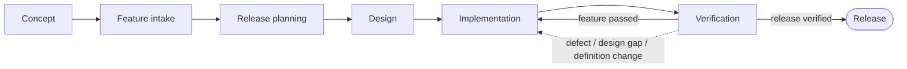

# AIRFlow

**A structured, human-approved development workflow for AI coding agents.**

AI agents are great at writing code, but left alone they tend to skip steps:
they start building before the problem is understood, forget what was decided
last session, or declare work "done" without evidence. AIRFlow gives an agent
a clear process to follow, with explicit places where it must stop and ask a
human.

## Why AIRFlow?

- **Predictable process** – the agent follows a defined flow instead of improvising.
- **Human in control** – concept, scope, design and release decisions need explicit approval. The agent never approves its own work.
- **Resumable** – all decisions, status and evidence are stored in the project's `.air/` folder, so work can be picked up again in a new session or by another agent.
- **Traceable** – changes to requirements or design invalidate only the approvals and verification they affect, and every step leaves evidence.
- **Tool-agnostic** – plain Markdown and Mermaid files; no runtime, no dependencies. It works with any agent that can read files or fetch URLs.

AIRFlow does not grant extra permissions. It always yields to your system,
repository and organization instructions.

## How it works

The process is described as [Mermaid](https://mermaid.js.org) flowcharts in
[`flows/`](https://github.com/vanlangenlabs/airflow/tree/main/flows). The entry point is [`project.mmd`](flows/project.mmd), which
orchestrates the phases below. Each phase is its own subflow.

| Phase | Flow | Purpose |
| --- | --- | --- |
| Concept | [`concept.mmd`](flows/concept.mmd) | Establish what the project is and why it exists |
| Feature intake | [`feature-intake.mmd`](flows/feature-intake.mmd) | Collect and approve a backlog of features |
| Release planning | [`release-planning.mmd`](flows/release-planning.mmd) | Choose the scope of the next release |
| Design | [`design.mmd`](flows/design.mmd) | Design the solution for the scoped features |
| Implementation | [`implementation.mmd`](flows/implementation.mmd) | Build (or rework) one feature at a time |
| Verification | [`verification.mmd`](flows/verification.mmd) | Check features and the release with evidence |
| Definition | [`definition.mmd`](flows/definition.mmd) | Revise a feature definition when verification reveals a change |

In short:



(This is a simplified overview; the real flows contain many more decisions,
approval gates and repair loops.)

## Using AIRFlow in your project

Point your agent at [`airflow.md`](airflow.md). For GitHub Copilot, add this to
your repository's `.github/copilot-instructions.md` (see
[`copilot-instructions.md`](copilot-instructions.md) for the template):

```markdown
# AIRFlow

For development work, read and follow https://raw.githubusercontent.com/vanlangenlabs/airflow/main/airflow.md
before acting or resuming. It defines the workflow and links to its Mermaid flows.
If inaccessible, report the limitation and request an accessible copy; do not guess.
```

**Starting a brand-new repository?** You can also paste this same text (without the
`# AIRFlow` heading) as the first prompt when you jump-start a new repository with
Copilot on GitHub. The agent then follows AIRFlow from the very first step, and you
can add the file to `.github/copilot-instructions.md` afterwards to keep it in place.

The agent then reads `airflow.md`, follows `flows/project.mmd`, and keeps its
records in a `.air/` folder in **your** repository (not in this one).

## Repository contents

| Path | Audience | Description |
| --- | --- | --- |
| [`airflow.md`](airflow.md) | AI agent | The core operating instructions: entry point, rules, authority and a short status overview. Always loaded |
| [`reference/*.md`](https://github.com/vanlangenlabs/airflow/tree/main/reference) | AI agent | Detailed rules loaded only when needed: statuses, approvals, workspace templates, resume validation and the interaction protocol |
| [`flows/*.mmd`](https://github.com/vanlangenlabs/airflow/tree/main/flows) | AI agent & humans | The workflow itself, as Mermaid flowcharts with embedded node context |
| [`copilot-instructions.md`](copilot-instructions.md) | You | Snippet to hook AIRFlow into GitHub Copilot |

`airflow.md` and the `.mmd` files are written for an AI to read, so they are
deliberately dense. For a human-friendly view, use the
[viewer](https://airflow.vanlangen.org).

## Viewing the diagrams

The [website](https://airflow.vanlangen.org) opens the HTML workflow viewer.
Choose a workflow in the sidebar or follow a phase node in a diagram. Nodes with
embedded context open an explanation dialog, with a link to the phase diagram
where applicable. Breadcrumbs and browser Back/Forward support navigation.

Zoom with the buttons or mouse wheel and drag to pan; Reset fits the diagram.
The viewer includes light and dark themes, a collapsible Mermaid source panel,
source copying and downloads. **Get started** provides setup instructions for
Copilot, Codex and Claude Code, plus the Copilot Jumpstart prompt.

- Direct links use `?flow=project` or `?flow=concept` on the website root.
- Existing `/viewer/?diagram=flows/concept.mmd` links still work: `/viewer/`
  redirects to the HTML viewer and preserves the selected diagram.
- Original sources remain in `flows/*.mmd`; the current instructions and
  `reference/` rules remain available to agents.
- Markdown documentation retains the Primer theme and its diagram links.

### GitHub Pages integration

Keep Pages building from the repository root. `index.html` is the standalone
homepage, styled by `assets/viewer.css` and powered by `assets/viewer.js`.
`index.json` defines workflow navigation. Relative paths support custom domains
and project-site paths. `viewer.html` provides the compatibility redirect.
No additional build step or Jekyll plugin is needed. The `oldwebsite/` reference
copy is excluded from the Pages build.

The viewer loads pinned Mermaid 11.12.0 from jsDelivr and fonts from Google Fonts.
Internet access is required for these external assets. Loading and rendering
errors appear in the viewer. Diagrams use Mermaid's strict security mode;
node context is inserted as text with basic Markdown formatting.

## Contributing

Ideas, bug reports and improvements are welcome. See
[CONTRIBUTING.md](CONTRIBUTING.md) and our [Code of Conduct](CODE_OF_CONDUCT.md).

## License

See [LICENSE](LICENSE).

